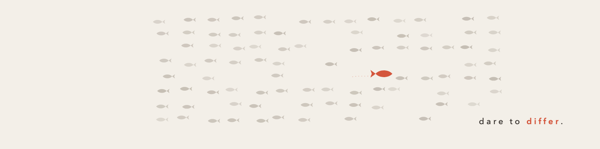

### Hi, I'm Fatemeh.

I build technology for moments that matter: for autistic people and their families, for people stepping away from gambling, for clinicians who need the right record at the right time.

I'm a product manager who still writes code. I like sitting with the people who have the problem, turning what they need into something clear, and then opening the editor and building it myself.

- **Now** · Co-founder & CTO at Zoyaar, a platform for autism care, built with NestJS, PostgreSQL and React
- **Before** · Product manager for a DLT-based brokerage, exchange and CSD at VERO · CTO of Predipie (50,000+ users)
- **Roots** · MSc in Artificial Intelligence and a long-standing curiosity about neuroscience

**Everyday tools** · NestJS · TypeScript · Node.js · PostgreSQL · Kafka · Redis · React · AI coding agents

Most of my work lives in private organisation repositories, so the contribution graph tells more of the story than the public repos.

[LinkedIn](https://www.linkedin.com/in/fabdollah90)
